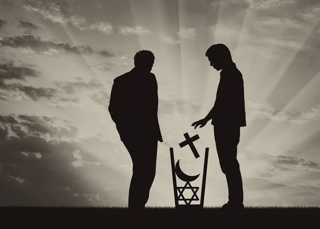

Saya tidak pernah merasa "pas" dan cocok dengan agama. Religion is not for me.

Sedari kecil saya adalah orang yang blak-blakan, iya iya enggak enggak. Saya juga orang yang literal, saya ngomong to the point. Saya orang yang banyak tanya, beritahu saya satu hal, kalau tidak logis yang akan saya lakukan adalah tidak peduli, atau kalau peduli akan saya pertanyakan habis-habisan.

Dari kecil saya dididik dengan dogma agama mayor yang jumlah pemeluknya >69% penduduk Indonesia. Selama menjadi bocah ingusan saya manut-manut saja dengan didikan orang tua saya, disuruh solat ya solat, disuruh ngaji ya ngaji, disuruh puasa ya puasa. Saya adalah (was) bocah yang penurut dan taat agama. Menurut saya sendiri agama saya dulu tidak buruk, saya gampang belajar, apapun yang dipelajari bisa saya tangkap.

Seiring usia saya bertambah saya mulai berani bikin keputusan sendiri, punya pendirian saya sendiri, mulai menentukan batas nyaman saya sendiri. Di sini saya merasa bahwa komunitas agama ini kurang cocok dengan saya.

Di acara keagamaan yang dibahas apa coba? Tetangga, tetangga di bulan puasa, urusan ranjang, urusan ranjang di bulan puasa, ini haram itu yang halal, baca alquran, baca alquran di bulan puasa, itu-ituuu terus.

Cara pendekatan para tokoh agama sudah ketinggalan jaman. Ambil hadis A, ambil pendapat B, tarik kesimpulan ini bagus ini nggak ini haram itu halal. Pengambilan keputusan tanpa dasar empiris, jadinya kesimpulan yang diambil kekurangan konteks dan kurang cocok diterapkan. Selain itu kebanyakan tokoh agama dan pembicara di acara keagamaan itu bapak-bapak usia 40 tahun. Mohon maaf, orang usia segini biasanya sudah mulai kolot dan tidak peka dengan perubahan. Kalau diberi kesempatan bicara pun bapack-bapack ini akan membicarakan masalah orang yang berusia 40 tahun, dengan konteks yang diapakai 40 tahun yang lalu.

Komunitas agama ini bagi saya kurang sreg. Seperti yang saya sebutkan di atas, main concern dalam hidup komunitas agama ini hanya sebatas ngurusin urusan tetangga, bapack-bapack yang kurang puas dalam urusan ranjang, dan urusan receh lainnya.

Dalam kehidupan beragama ini bertanya terlalu dalam, meragukan jawaban, dan mengkritik kurang disukai. Bagi saya lingkungan yang seperti ini sangat tidak nyaman.

Alasan lainnya, kalau diberikan suatu masalah dan diminta satu solusi, yang dijadikan jawaban adalah analogi. Dijawab muter-muter, tanpa ada definisi baku, tanpa ada batasan masalah, dasar teorinya pun dari ayat/hadis yang jarangkali pakai penyesuaian konteks. Kenapa 99% debat agama jadi debat kusir? jawabnnya ada di paragraf ini. Saya selalu mempertanyakan ini agama untuk apa kalau tidak solutif terhadap masalah? Lha klaimnya agama iu bimbingan, cuma sebatas klaim?

Selama saya memeluk agama ini saya merasa tidak cocok denga lingkungannya, tidak cocok dengan orientasinya, sedikit tidak cocok dengan ajarannya. Selama menjalani kehidupan religius jujur saya seperti berada di tempat yang salah. Tidak ada solusi yang empirik, isinya cuma analogi, cerita, ayat, dsbg. Apakah masalah-masalah saya terbantu dengan meyakini sebuah agama? tidak. Yang saya rasakan selama menjalani kehidupan religius hanyalah rasa bersalah dan ketakutan. Hingga sampai pada saat saya ingin berhenti beriman dan membebaskan pikiran saya.

Apa yang saya rasakan setelah meninggalkan agama saya? Yang pasti lebih nyaman, lebih leluasa berfikir, dan juga terbebas dari batasan "tabu" dalam berfikir (contoh: seks, narkoba, dll, di quora saya beberapa kali menjawab topik ini). Saya juga tidak perlu hadir di tempat dimana saya tidak merasa nyaman.
