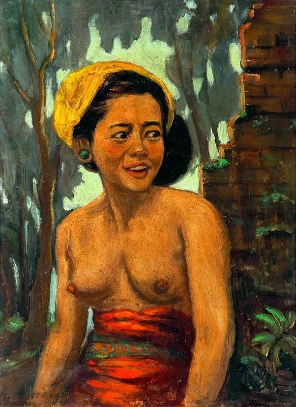

Simpelnya seperti ini, masyarakat Bali pada masa itu masih menerapkan sudut pandang seksual asli Nusantara, yaitu aurat wanita sebenarnya bermula dari pusar perut sampai ujung telapak kaki. Lelaki Bali tidak akan terangsang sama sekali melihat payudara wanita, yang hanya organ menyusui untuk bayi. Mereka justru akan bergairah ketika melihat paha wanita yang terbuka. Hal ini bisa kita buktikan pada kisah Ken Arok dan Ken Dedes sebelum kerajaan Singosari berdiri. Ken Arok merasa bergairah dan mulai tertarik dengan istri Tunggul Ametung tersebut setelah tidak sengaja melihat kain bagian bawah tubuh Ken Dedes tersingkap terkena angin ketika turun dari sebuah kereta kuda, sisa kisah selanjutnya Ken Arok mendirikan Kerajaan Singosari, hehehe.

Itu lah mengapa, jika anda ingin mengkritisi bagaimana wanita Bali saat itu berbusana dengan sudut pandang moralitas era sekarang tentu keliru. Kalau ditelisik, banyak peradaban yang juga sebenarnya 11–12 dengan Bali atau Nusantara pra-Islam seperti Siam, Korea bahkan Jepang yang wanitanya dahuli bertelanjang dada. Namun karena kiblat peradaban dan moralitas saat ini berkiblat pada dunia barat dan agama Abrahamik, masyarakat Bali pada akhirnya juga menganggap payudara sebagai organ seksual yang menggairahkan, bertolak belakang dengan leluhur mereka sendiri.

